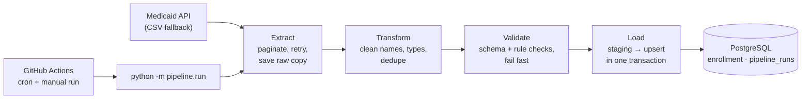

# Enrollment Data Pipeline

A small, tested data pipeline that pulls public Medicaid & CHIP enrollment data, cleans and validates it with pandas, and upserts it into PostgreSQL on a schedule with GitHub Actions.

<!-- TODO: add the CI badge once the repo is on GitHub:

-->

> Status: scaffold. The modules in `pipeline/` and the tests are stubs that describe what each file will contain.

## Architecture



## Quick start

```bash
docker compose up -d                 # local Postgres 16; applies sql/schema.sql on first start
cp .env.example .env                 # defaults point at local Postgres and the CMS API
python -m venv .venv && source .venv/bin/activate
pip install -r requirements.txt
python -m pipeline.run
```

## Tests

```bash
pip install -r requirements-dev.txt
ruff check .
pytest --cov=pipeline --cov-report=term-missing
```

Unit tests need nothing external. The integration tests in `tests/test_load.py` need a running Postgres and `DATABASE_URL` set; without it they are skipped.

## Design decisions

- **Idempotent upsert.** `INSERT ... ON CONFLICT (state_code, report_month) DO UPDATE`, so rerunning a load never duplicates data.
- **Validation gate.** Bad data fails the run before anything touches the main table. Postgres constraints are a second line of defense.
- **Single transaction.** The staging write and the upsert share one transaction, so a crash never leaves half a load.
- **Run audit table.** Every run writes a row to `pipeline_runs` (start, end, status, row counts, error).

## Sample queries

```sql
-- Latest month, top 5 states by total enrollment
SELECT state_code, total_enrollment
FROM enrollment
WHERE report_month = (SELECT max(report_month) FROM enrollment)
ORDER BY total_enrollment DESC
LIMIT 5;

-- Did the scheduled job work?
SELECT started_at, status, rows_loaded, error
FROM pipeline_runs ORDER BY run_id DESC LIMIT 5;
```

## Data source

[State Medicaid and CHIP Applications, Eligibility Determinations, and Enrollment Data](https://data.medicaid.gov/dataset/6165f45b-ca93-5bb5-9d06-db29c692a360), published by the Centers for Medicare & Medicaid Services on data.medicaid.gov.

- **Coverage:** 50 states plus DC, monthly from September 2013, updated monthly with roughly a three-month lag.
- **Access:** public JSON API with `limit`/`offset` paging, no API key. The same data is available as a CSV download, which the pipeline uses as a fallback.
- **License:** U.S. government work ([usa.gov/government-works](https://www.usa.gov/government-works)).
- **Preliminary vs. updated:** most state-months appear twice, once as a preliminary report and once as an updated final report, often with different totals. The pipeline keeps one row per state and month.

## Roadmap

- [ ] Second dataset + join (e.g., population for per-capita rates)
- [ ] Incremental loads (only new months)
- [ ] pandera schema; data-freshness check
- [ ] Postgres `COPY` for speed; SQL views for reporting
- [ ] Failure alert to a Teams/Slack webhook; Dockerfile
- [ ] Small chart or dashboard from the loaded table
